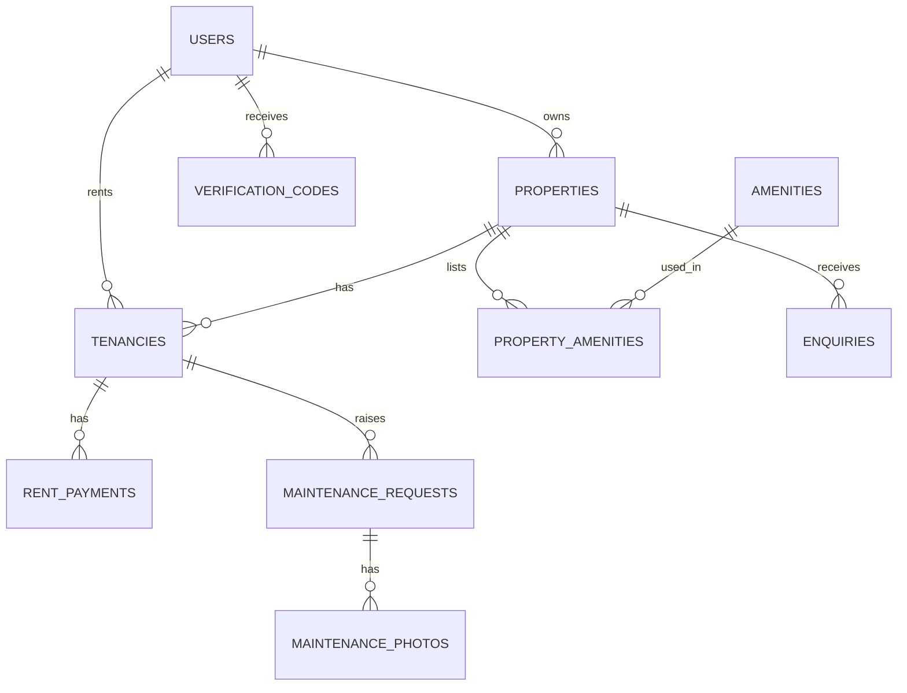

# RentConnect backend

Flask + SQLAlchemy REST API for RentConnect. It follows the same pages as the React frontend.

## Setup (Linux, pipenv)

```
cd rentconnect-backend
pipenv install -r requirements.txt
pipenv shell
cp .env.example .env
python create_db.py    # creates the tables in a local rentconnect.db
python seed.py         # sample data (after all models are merged)
flask run              # http://localhost:5000
```

Check it works: open http://localhost:5000/api/health.
Who builds which file, and the order to push, is in `BACKEND_TEAM.md`.
The shared migration (`flask db init`, `flask db migrate`, `flask db upgrade`) is created once by
Member 1 after every model is merged. Until then use `create_db.py`, and delete your local
`rentconnect.db` before you switch to migrations.

Sample accounts (created by `seed.py`):

| Role | Email | Password |
|---|---|---|
| Admin | admin@rentconnect.test | Admin12345 |
| Landlord | landlord@rentconnect.test | Landlord123 |
| Tenant | jane@rentconnect.test (also brian@, mercy@) | Tenant1234 |

## Tests

```
pipenv install -r requirements-dev.txt
pytest                      # all tests
pytest tests/test_landlord.py   # only your own file
```

Tests use a throw-away in-memory database, so they never touch `rentconnect.db`, and they do not need
Cloudinary keys or the internet. Each member owns the test files for their own routes (see `BACKEND_TEAM.md`).
A test file works once the models it uses have been merged into `develop`.

## Image uploads (Cloudinary)

1. Make a free account at cloudinary.com. On the Dashboard, open API Keys and copy the cloud name, API key and API secret.
2. Put them in your `.env` as `CLOUDINARY_CLOUD_NAME`, `CLOUDINARY_API_KEY` and `CLOUDINARY_API_SECRET`. Never commit `.env`.
3. `pipenv install cloudinary`, then restart `flask run`.

How it works: the frontend sends the file to `POST /api/uploads/image` and gets back a link. It then saves that
link in the normal JSON requests: `image_url` when adding or editing a property, `photo_urls` for a maintenance request.
Without the three settings, uploads answer 503 and the rest of the API still works.
Each team member uses their own keys locally, or the team shares one account.

## How sign-in works

1. `POST /api/auth/login` with email and password. A 6-digit code is "emailed" (printed in the server
   log, and also returned as `dev_code` while `SHOW_DEV_CODES=true`).
2. `POST /api/auth/verify` with email and code. You get back `access_token`.
3. Send it on every protected request: `Authorization: Bearer <access_token>`.

## Endpoints

Errors always look like `{"error": "message", "fields": {"name": "problem"}}`.

| Method and path | Who | What it does |
|---|---|---|
| GET `/api/health` | anyone | Server check |
| GET `/api/meta` | anyone | Dropdown values (types, categories, statuses, amenities) |
| POST `/api/auth/register` | anyone | Create a tenant or landlord account |
| POST `/api/auth/login` | anyone | Step 1: password, sends a code |
| POST `/api/auth/verify` | anyone | Step 2: code, returns the token |
| POST `/api/auth/forgot-password` | anyone | Sends a reset link |
| POST `/api/auth/reset-password` | anyone | `{token, password}` sets a new password |
| GET / PATCH `/api/auth/me` | signed in | View or edit your profile and email notifications |
| POST `/api/uploads/image` | landlord, tenant | Upload one image (multipart field `file`, JPG/PNG/WebP, max 2 MB). Returns `{url, public_id}` |
| GET `/api/properties` | anyone | Search: `location, min_rent, max_rent, type, bedrooms, availability, page, per_page` |
| GET `/api/properties/<id>` | anyone | Property details |
| POST `/api/properties/<id>/enquiries` | anyone | Send an enquiry to the landlord |
| GET `/api/landlord/dashboard` | landlord | Dashboard numbers and recent rent |
| GET, POST `/api/landlord/properties` | landlord | My properties, add a property (starts as `pending`) |
| GET, PUT, DELETE `/api/landlord/properties/<id>` | landlord | One property |
| GET `/api/landlord/tenants` | landlord | Tenants (`?include_ended=true` for past ones) |
| POST `/api/landlord/tenancies` | landlord | Assign a tenant (by email) to a vacant property |
| PATCH `/api/landlord/tenancies/<id>` | landlord | Change status (`active`, `notice`, `ended`) or end date |
| GET `/api/landlord/payments` | landlord | Rent records |
| POST `/api/landlord/tenancies/<id>/payments` | landlord | Record a rent payment |
| PATCH `/api/landlord/payments/<id>` | landlord | Change a payment status |
| GET `/api/landlord/maintenance` | landlord | Requests (`?status=`) |
| GET, PATCH `/api/landlord/maintenance/<id>` | landlord | Details, update status |
| GET `/api/tenant/dashboard` | tenant | Tenancy, recent payments, requests |
| GET `/api/tenant/tenancy` | tenant | Current rented property |
| GET `/api/tenant/payments` and `/<id>` | tenant | Rent history, payment details |
| POST, GET `/api/tenant/maintenance` | tenant | Report an issue, list my requests |
| GET `/api/tenant/maintenance/<id>` | tenant | Request details |
| GET `/api/admin/stats` | admin | Totals |
| GET `/api/admin/users` | admin | Users (`?role=&status=`) |
| PATCH `/api/admin/users/<id>/status` | admin | `{"status": "active" or "suspended"}` |
| GET `/api/admin/properties` | admin | Properties (`?approval_status=`) |
| PATCH `/api/admin/properties/<id>/approval` | admin | `{"approval_status": "approved" / "rejected" / "pending"}` |

## Connecting it to the frontend

- Backend values are lowercase with underscores (`in_progress`, `vacant`, `paid`). The frontend shows
  words like "In progress", so add a small label map when you connect them.
- Frontend field names are camelCase in places (`monthlyRent`); the API uses `monthly_rent`, `property_type`.
- Add `http://localhost:5173` to `CORS_ORIGINS` (already the default).
- The frontend currently has `/reset-password` without a token. The email link is
  `/reset-password?token=...`, so that page must read the token from the URL and send it back.

## Not done yet (be honest about these in the demo)

- Deleting old images from Cloudinary when a property image is replaced (old files stay in your account).
- Real emails: `send_email()` in `app/utils.py` only writes to the log.
- Limits on wrong verification codes and login attempts (add Flask-Limiter before real use).
- Automated tests.
- Rent payments are recorded by the landlord. There is no live M-Pesa or card payment.

## Database diagram



Relationships in plain words: one landlord owns many properties. A tenancy links one tenant to one
property for a period. Rent payments and maintenance requests belong to a tenancy. Properties and
amenities are many-to-many through `property_amenities`.
